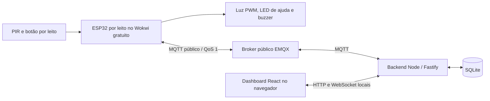

# NightCare

MVP acadêmico de Microprocessadores e Microcontroladores para apoiar deslocamentos noturnos: ESP32, sensor de movimento, luz com brilho ajustável e botão de ajuda. Cada leito tem um ESP32 independente; o cuidador acompanha os leitos e atende chamados pelo dashboard único.

**O caminho principal é gratuito:** Wokwi no navegador, broker MQTT público sem cadastro e backend/dashboard no seu computador. Não exige gateway privado, VPS, domínio, cartão ou abertura de portas no roteador. Use somente dados fictícios: o broker da demonstração é público, sem autenticação ou privacidade. O projeto é um sistema de apoio, sem certificação médica ou garantia de prevenção de quedas.

## Começar em poucos passos

Requisitos: Docker com Compose v2, Python 3, Bash, internet e navegador. Docker Desktop precisa ter acesso à pasta do projeto. Não é necessário instalar Node para executar pelo Docker.

### Preparar o Windows (Docker Desktop e Git Bash)

1. Baixe o [Docker Desktop para Windows](https://docs.docker.com/desktop/setup/install/windows-install/) e execute o instalador. Use o backend **WSL 2** e contêineres **Linux**. Se o WSL ainda não estiver instalado, abra o **PowerShell como administrador**, execute `wsl --install` e reinicie o computador. A virtualização precisa estar habilitada na BIOS/UEFI; confira os requisitos do Windows na página oficial.
2. Abra o **Docker Desktop** pelo menu Iniciar e aguarde o mecanismo Docker ficar em execução. Mantenha o aplicativo aberto durante a demonstração; ele já inclui o Compose v2.
3. Baixe e instale o [Git for Windows](https://git-scm.com/install/windows), que inclui o **Git Bash**. Mantenha os componentes padrão, incluindo a integração com o Explorador de Arquivos. Após instalar, abra **Git Bash** pelo menu Iniciar ou use **Open Git Bash here** no menu de contexto da pasta `NightCare` (no Windows 11, pode estar em **Mostrar mais opções**).
4. Instale também o [Python 3 para Windows](https://www.python.org/downloads/windows/), caso ainda não tenha. Ao usar o instalador tradicional, marque **Add python.exe to PATH**. Feche e reabra o Git Bash após as instalações para atualizar o PATH.
5. No **Git Bash**, entre na pasta do projeto e confira os requisitos. Por exemplo, para um projeto em `C:\Users\SeuNome\Downloads\NightCare`:

   ```bash
   cd "/c/Users/SeuNome/Downloads/NightCare"
   docker info
   docker compose version
   python3 --version
   ```

   Substitua `SeuNome` pelo seu usuário e ajuste o caminho se necessário. `docker info` deve mostrar a seção **Server** sem erro; se falhar, confirme que o Docker Desktop terminou de iniciar.

   O script exige o comando `python3`. Se ele não existir ou abrir a Microsoft Store, mas `python --version` mostrar Python 3, execute no Git Bash:

   ```bash
   python3() { python "$@"; }
   export -f python3
   python3 --version
   ```

   Essa adaptação vale para a sessão atual do terminal e é herdada pelo `bash scripts/demo.sh`.

### Executar a demonstração

Na raiz do projeto, execute no Bash (no Windows, use o **Git Bash** preparado acima):

```bash
bash scripts/demo.sh
```

O script prepara uma configuração exclusiva e inicia o backend com o dashboard. Abra **http://localhost:3000**. O painel abre sem login; o dispositivo ficará offline até iniciar a simulação.

Se a porta 3000 já estiver em uso:

```bash
DEMO_HTTP_PORT=3001 bash scripts/demo.sh
```

Nesse caso, abra http://localhost:3001 e use a mesma variável em futuras execuções. Para preparar apenas os arquivos do Wokwi, sem iniciar Docker:

```bash
bash scripts/demo.sh --prepare-only
```

O script gera `.env.demo`, `Wokwi/mqtt_demo.h` para compilação padrão e um pacote por dispositivo em `Wokwi/demo/<deviceId>/`. Os quatro arquivos diretos de `Wokwi/demo/` continuam como alias de `nightcare-001`. Ele reutiliza o identificador nas execuções seguintes, não altera `.env`, `secrets/` ou `mqtt_secrets.h` da modalidade TLS e recusa substituir um `mqtt_demo.h` que pertença a outra configuração. Não copie `.env.demo` entre demonstrações independentes: cada instalação precisa de seu próprio prefixo.

### Iniciar a simulação gratuita

1. Abra o [circuito original no Wokwi](https://wokwi.com/projects/479504505300117505) e crie sua cópia.
2. Substitua `sketch.ino`, `diagram.json` e `libraries.txt` pelos arquivos de **`Wokwi/demo/nightcare-001/`** gerados pelo script.
3. No editor do Wokwi, crie um arquivo/aba com o nome exato **`mqtt_demo.h`** e cole todo o conteúdo de `Wokwi/demo/nightcare-001/mqtt_demo.h`. Salve antes de iniciar a simulação. Os quatro arquivos necessários são `sketch.ino`, `diagram.json`, `libraries.txt` e `mqtt_demo.h`; **não é necessário adicionar `mqtt_secrets.h`, `mqtt_secrets.example.h` ou `mqtt_demo.example.h`**. Não copie `wokwi.toml` para o navegador.
4. Inicie a simulação. Use o gateway público padrão; não habilite o gateway privado.
5. No monitor serial, acompanhe Wi-Fi e a mensagem MQTT conectado. No painel, aguarde o dispositivo ficar online.
6. Clique no PIR e em **Simulate Motion**. Pressione o botão AJUDA para abrir um chamado.

A rede simulada é `Wokwi-GUEST`, sem senha, e o NTP usa `pool.ntp.org`. Aguarde a sincronização antes de reconhecer/encerrar pelo painel. Para testar iluminação durante o dia, envie pelo painel agenda **00:00–00:00**, ou use o modo **Ligado**. Horários iguais significam funcionamento automático 24 h.

O ESP32 conecta a `broker.emqx.io:1883` pela internet; o backend conecta ao mesmo broker. **Não use `localhost`, `mosquitto` ou `host.wokwi.internal` como endereço MQTT no Wokwi deste roteiro.** O gateway público não acessa sua rede local. [Rede e gateway público do Wokwi](https://docs.wokwi.com/guides/esp32-wifi)

### Credenciais e parâmetros da demo

| Parâmetro | Valor / origem |
| --- | --- |
| Broker | `broker.emqx.io`, TCP `1883` |
| Usuário e senha MQTT | vazios; serviço público sem autenticação |
| Painel, API e WebSocket | sem login ou token em ambas as modalidades |
| Wi-Fi | `Wokwi-GUEST`, senha vazia |
| Namespace da instalação | `nightcare/demo/<identificador>/` |
| Tópicos de cada dispositivo | `nightcare/demo/<identificador>/<deviceId>/...` |
| Identificador da instalação | 16 caracteres hexadecimais gerados em `.env.demo` |
| Client IDs | `nightcare-<identificador>-backend` e `nightcare-<identificador>-<deviceId>` |
| API/dashboard | `http://localhost:3000`, apenas loopback |

Não há segredos a solicitar ou configurar no modo demo. O prefixo exclusivo evita colisões acidentais, mas qualquer pessoa pode ler ou publicar mensagens se conhecer o tópico. Nunca envie dados pessoais ou credenciais por esse broker. O EMQX disponibiliza o serviço para protótipos e testes, sem necessidade de preparar infraestrutura. [Endereço e portas do broker público](https://www.emqx.com/en/mqtt/public-mqtt5-broker)

## Dois leitos, duas simulações e descoberta

```bash
bash scripts/demo.sh --devices nightcare-001,nightcare-002
# Para preparar sem iniciar o backend:
bash scripts/demo.sh --prepare-only --devices nightcare-001,nightcare-002
```

1. Abra dois projetos/cópias distintos do circuito em janelas separadas do Wokwi; não apenas duas abas do mesmo projeto salvo. Use um único ESP32 por simulação.
2. Na primeira, copie os quatro arquivos de `Wokwi/demo/nightcare-001/`; na segunda, os de `Wokwi/demo/nightcare-002/`. O arquivo `mqtt_demo.h` é diferente em cada pacote.
3. Inicie ambas e mantenha as duas janelas ativas/visíveis quando possível. Cada uma conecta ao broker público, com ID, client ID e tópicos próprios; não é necessário gateway privado nem comunicação direta entre simuladores.
4. Em **Administração → Dispositivos e leitos**, confira os IDs encontrados, informe **Leito 1** e **Leito 2** e confirme as associações. Aguarde estado novo: uma fotografia retida não habilita associação.
5. No Dashboard, observe todos os cartões ou use **Buscar leito ou dispositivo** para filtrar por nome/ID localmente. Abra iluminação/assistência pelo cartão; nas telas de operação, troque o leito em **Dispositivo em acompanhamento**. Movimento, parâmetros, chamados, comandos, relógio e presença são independentes.

O backend descobre mensagens válidas **dentro do namespace da instalação**; não procura equipamentos pela rede local nem em todos os tópicos do broker. O anúncio revela a identidade, mas o operador confirma onde o dispositivo foi instalado. O firmware não conhece o nome do leito.

A associação exige dispositivo online, ID ainda sem leito e nome único (desconsiderando maiúsculas/minúsculas). É permanente nesta versão: não há transferência, desassociação, exclusão ou substituição. É possível corrigir o nome sem mudar o vínculo. Dispositivos ainda sem leito continuam visíveis, inclusive com chamados conhecidos, mas não recebem configuração ou atendimento remoto antes da confirmação.

IDs aceitam 1–32 letras ASCII, números, `_` e `-`; `nightcare-backend` e `nightcare-health` são reservados. São permanentes por pacote e não dependem do MAC simulado. Reexecutar a preparação preserva o namespace e acrescenta pacotes, sem apagar identidades anteriores. Não execute duas simulações com o mesmo pacote/client ID. O backend não consegue autenticar ou distinguir clones que imitem uma identidade no broker público.

Um banco antigo é migrado em transação: dados de `nightcare-001` permanecem disponíveis como **Leito 1**. Esse vínculo não precisa ser confirmado de novo; seu nome pode ser corrigido. Instalação nova começa sem leitos e exige confirmação de cada dispositivo. Configurações e históricos anteriores ao vínculo continuam ligados ao deviceId e ficam consultáveis pelo leito após associação; renomear atualiza o rótulo exibido.

A arquitetura de simulações separadas usa o [acesso MQTT à internet do Wokwi](https://docs.wokwi.com/guides/esp32-wifi). A [FAQ oficial](https://docs.wokwi.com/faq#how-do-i-use-multiple-microcontrollers-in-a-single-project) informa que múltiplos microcontroladores em um único projeto não são suportados. Duas sessões independentes com broker público são a abordagem adotada aqui; sua execução simultânea ainda precisa ser observada no Wokwi. Testes com clientes MQTT não comprovam a execução do firmware.

## Arquitetura



O ESP32 controla iluminação, agenda, debounce e sinalização de ajuda. A rede roda em tarefa própria e entrega mensagens ao loop por fila FreeRTOS. Falha de internet não interrompe PIR, botão ou saídas locais.

O broker encaminha eventos, estado, configurações e comandos. O backend valida as mensagens, registra histórico em SQLite e confirma ações somente após resposta do dispositivo. O dashboard acessa o backend; não conecta diretamente ao ESP32 nem ao broker.

O frontend React/TypeScript é compilado com Vite e servido pelo próprio Fastify. HTTP e WebSocket usam o mesmo endereço, sem outro servidor de frontend. O backend envia snapshots iniciais e alterações por `/ws`; o painel reconecta automaticamente e recupera o histórico. O banco usa WAL e preserva configurações desejadas, pedidos e comandos antes de publicá-los.

| Parte | Arquivos principais |
| --- | --- |
| Firmware e circuito | `Wokwi/sketch.ino`, `Wokwi/diagram.json` |
| Dashboard único em `/` | `frontend/src/` (`/dashboard` e `/dashboard/` redirecionam para `/`) |
| API, MQTT e SQLite | `backend/src/` |
| Execução gratuita | `compose.demo.yml`, `scripts/demo.sh` |
| Alternativa com broker próprio/TLS | `compose.yml`, `mosquitto/`, `scripts/setup.sh` |
| Testes | `backend/test/`, `scripts/test-*.sh` |

### Estados e confirmações

Iluminação, assistência e comunicação são independentes. Desconectar MQTT não encerra um chamado nem muda o modo de luz.

O painel apresenta conexão WebSocket, broker e dispositivo separadamente. Estado retido é uma fotografia: o backend espera mensagem nova para indicar presença e considera offline após **45 s** sem atualização, ou ao receber `offline`. O ESP32 envia heartbeat a cada **15 s**.

Ao enviar configuração, o painel mostra a versão desejada e a versão aplicada pelo ESP32. Um HTTP **202** indica intenção registrada; a confirmação vem de `acks` ou de `state.appliedConfigVersion`. Mudanças locais por serial não incrementam a versão remota: confira também os valores atuais nos cartões.

O botão abre um pedido `PENDING`. **Reconhecer** muda para `ACKNOWLEDGED`; **Encerrar** só é permitido depois e retorna a `NONE`. Chamados não expiram com a luz. Novos cliques reiteram o mesmo pedido. O painel mantém o aviso, mostra o tempo desde a primeira observação da abertura e oferece som ativado pelo usuário; exige aba aberta e conectada. Para registros anteriores à migração, a abertura usa o primeiro recebimento disponível, ou a última atualização quando não há histórico.

Comandos exibem enviado, confirmado, recusado ou **não confirmado** após dez segundos sem ACK. São válidos por 60 s. O painel bloqueia ações incompatíveis e aguarda a confirmação; o backend e o firmware também validam pedido, relógio e transição. Um ACK MQTT de transporte não confirma atendimento.

## Navegação do painel

A barra lateral pode ser expandida ou recolhida. No celular, o botão de menu abre as mesmas opções. Cada tela possui endereço próprio (`#dashboard`, `#iluminacao`, `#assistencia`, `#administracao`) e funciona com voltar/avançar do navegador.

| Tela | Uso |
| --- | --- |
| Dashboard | cartões de todos os leitos; ícones e sinais visuais de movimento, luz, relógio, presença e chamados simultâneos |
| Iluminação e movimento | estado da luz/PIR; cartão único de ajustes com prévia de brilho, horários próprios, detalhes e três gráficos por leito |
| Assistência | pedido ativo, acionamentos do botão, tempo desde abertura, reconhecer/encerrar e resultados das últimas ações |
| Administração | header por dispositivo, registro/associação, configurações e diagnóstico, presença e comunicações observadas em 24 horas |
| Histórico | dois cards paginados: Eventos/Chamados/Configurações em abas e Comandos; filtros e consulta global ou por dispositivo |

Os cartões do Dashboard mostram cada estado com ícone, texto e destaque visual: lâmpada dourada com brilho quando acesa e riscada quando apagada, sinal pulsante durante movimento, sino e borda dourada para chamado pendente, confirmação para atendimento reconhecido e alerta para relógio inválido. Ao mudar um valor, há uma transição breve; heartbeats sem mudança não reiniciam essa transição. Sem dados, o cartão informa ausência de informação. Offline ou sem conexão do painel, os indicadores ficam neutros e sem animação de atividade, preservando somente a última informação recebida. Movimento reduzido desativa as animações e mantém ícones/textos/cores. Os botões ficam sempre no rodapé dos cartões; o selo Offline/Sem conexão e os indicadores neutros substituem a mensagem adicional nesses cartões.

O sino de notificações e o controle de som ficam disponíveis em todas as telas. Trocar de tela ou de dispositivo preserva separadamente os formulários e filtros de cada dispositivo. O áudio é global e considera qualquer chamado pendente; a lista global identifica o destinatário. A seleção fica no parâmetro `device` do endereço. A conexão em tempo real é compartilhada. Administração organiza as informações existentes; não cria um perfil de acesso separado.

O **sino** abre a central global: presença, movimento, luz, chamados, configurações, comandos, associação/renomeação e diagnósticos. Há filtros por dispositivo/categoria e paginação. O histórico fica no SQLite por **30 dias**, sem apagar as coleções técnicas. A central começa a registrar após esta atualização, sem converter registros antigos. O nome do leito é preservado como era na ocorrência; o ID continua identificando o dispositivo.

Os seletores de dispositivo, modo e filtros usam o mesmo componente visual da aplicação, com lista escura, destaque dourado e indicação da seleção. Clique ou use Enter/Espaço para abrir, setas/Home/End para navegar, digitação para localizar uma opção, Enter para escolher, Escape para fechar e Tab para avançar. A lista se ajusta ao espaço disponível, inclusive dentro da central. O sino e o painel têm animações de abertura/fechamento, respeitando movimento reduzido.

O contador é de não lidas neste navegador e instalação. Abrir ou atualizar a central preserva as não lidas. **Marcar todas como lidas** zera o contador, remove os destaques e exibe uma confirmação; a leitura continua salva após recarregar. A consulta aberta mantém suas páginas: use **Atualizar · novas notificações** para trazer novidades. Todas as novas notificações também geram toasts de oito segundos (pausados com mouse/foco), incluindo presença, movimento e luz, no máximo três ao mesmo tempo, com resumo em rajadas. Cada toast identifica o leito/dispositivo e permite abrir os detalhes correspondentes. Histórico inicial/reconexão não dispara avisos retroativos. O som continua exclusivo dos chamados, mediante ativação do usuário. Falha no broker é um aviso global, sem gerar uma falsa queda individual de cada dispositivo; a desconexão navegador/backend é um aviso local.

A presença exige estado novo: dados retidos não indicam online. Heartbeats e mensagens repetidas não geram notificações; diagnóstico considera a última telemetria recebida ao vivo. Configurações sem confirmação em dez segundos ganham um aviso, mas a intenção continua pendente e pode ser confirmada depois. As notificações cobrem apenas o que o backend recebeu/observou: a limitação de entrega quando ele está parado continua válida. Não há push do sistema operacional ou envio de mensagens externas.

Modo e brilho atuais vêm do estado do ESP32. O firmware atualizado também publica agenda, prazo e offset UTC efetivamente ativos em `runtimeSettings`, incluindo alterações pelo serial. O painel separa esses parâmetros da configuração remota confirmada e da última configuração enviada. Firmware anterior continua aceito: nesse caso o painel informa a ausência dessa telemetria. A versão confirmada é consultada diretamente no banco, mesmo fora das 30 configurações recentes. Offline, os dados são identificados como última informação recebida.

Em **Iluminação e movimento**, **Automático / Ligado / Desligado** agora alteram somente o rascunho. **Aplicar configuração** envia modo, brilho, prazo e agenda juntos; não existe mais troca imediata de modo nessa tela. O slider de 1–100% muda a intensidade de uma lâmpada de **prévia local**, sem alterar o indicador do dispositivo real antes da confirmação. O seletor de horários usa a interface do app em formato 24 h, com hora/minuto e **Definir horário** ou **Cancelar**. Horários iguais continuam significando agenda de 24 h.

Os detalhes de configuração foram removidos de Iluminação e movimento; permanecem disponíveis na Administração. Rascunho e período dos gráficos são preservados separadamente por leito durante a navegação. Explicações ficam nos botões **?**, acessíveis por hover, foco ou toque. Entradas dos cartões, lâmpada, movimento e gráficos têm animações discretas; heartbeats não as reiniciam e movimento reduzido as desativa.

Em telas grandes, ajustes e análise ficam lado a lado; os gráficos inferiores têm a mesma largura. Até 1100 px os gráficos ficam empilhados. Os gráficos têm altura compacta e cores douradas/violeta da aplicação, com valores acessíveis por hover, toque e teclado.

Os gráficos oferecem **24 h, 7 dias, 30 dias e Agenda do leito**: movimentos por hora do dia, comparação de movimentos com acionamentos da luz e distribuição dentro/fora da agenda. Os dois primeiros têm valores por toque/mouse/teclado; a distribuição expõe quantidades e percentuais em texto. A consulta é agregada no backend sobre todo o período, sem limitação à página de 100 eventos. Horários de ocorrência têm prioridade; registros sem horário original usam recebimento e são identificados como aproximados. UTC usa o offset efetivo da referência (ou UTC−3 sem referência).

A classificação usa **a agenda atual como referência**, obtida dos parâmetros efetivos ou da versão remota confirmada; nunca usa uma edição nem uma intenção pendente. Não reconstrói alterações antigas pelo serial. Sem agenda conhecida, a classificação fica indisponível; sem registros, há estado vazio. Acionamentos não significam duração nem consumo energético, e ausência de registros não comprova ausência física de movimento. Gráficos mantêm a última consulta se houver falha ou desconexão, com aviso; alterações de período/leito descartam respostas atrasadas. Atualizações por eventos são agrupadas em até uma consulta a cada dois segundos, além de uma atualização por minuto da janela. Só o leito visível é consultado.

Evoluções possíveis: mapa de calor por dia/horário, comparação entre leitos e duração da iluminação com identificação de lacunas.

A página **Histórico** consulta eventos, chamados, comandos e configurações em páginas de 25 registros, com **Anterior**, **Próxima** e **Atualizar consulta**. Filtros e alcance global/dispositivo são independentes por coleção. IDs, parâmetros, horários, validade e motivos permanecem disponíveis nos detalhes. Configurações e diagnóstico do último estado recebido ficam na Administração.

## Circuito e controle local

| Componente | Ligação |
| --- | --- |
| PIR OUT | GPIO 27, alimentação 5 V e GND |
| Botão AJUDA | GPIO 14 e GND, `INPUT_PULLUP` |
| LED branco, representando luminária | GPIO 25, resistor 220 Ω e GND |
| LED vermelho de assistência | GPIO 26, resistor 220 Ω e GND |
| Buzzer | GPIO 32 e GND |

Padrões: `AUTO`, brilho **30%**, prazo **30 s**, agenda **22:00–06:00**, São Paulo/UTC−3 fixo. O início da agenda é inclusivo e o fim exclusivo. `ON` mantém luz no brilho configurado; `OFF` mantém apagada. Em `AUTO`, sair da agenda apaga imediatamente. PIR ativo mantém luz ligada; o prazo começa quando fica inativo e novo movimento cancela o desligamento.

Sem relógio válido, `AUTO` aceita movimento o dia todo e informa `clockValid=false`. O botão funciona a qualquer hora, inclusive com luz desligada. Debounce: 50 ms. Pedido pendente: LED alterna a cada 500 ms e buzzer toca 100 ms a cada 5 s. Reconhecido: LED aceso e buzzer silencioso.

A operação e a apresentação estão no [manual da interface](docs/manual.md). Comandos do monitor serial (115200 baud), relógio de teste, reinício e ensaios locais ficam exclusivamente no [manual do serial](docs/serial.md).

Configuração e chamado ativo são NVS; fila e contador de perdas são RAM e desaparecem no reboot. Reinício do firmware e parar/reabrir o Wokwi são ensaios distintos, pois a preservação da flash depende do simulador.

## Testes automatizados e compilação

```bash
python3 scripts/test-prepare.py
bash scripts/test-backend.sh
bash scripts/test-demo.sh
bash scripts/test-integration.sh
bash -n scripts/demo.sh scripts/setup.sh scripts/test-backend.sh scripts/test-demo.sh scripts/test-integration.sh
```

Os testes usam Node 22 em Docker. `test-demo.sh` também valida dois dispositivos com movimento, configuração, chamados e presença independentes. `test-prepare.py` verifica geração/repetição de pacotes e recusa de sobrescrita incompatível. `test-demo.sh` cria broker anônimo **isolado, sem publicar portas**, backend e SQLite temporários; verifica dashboard servido, WebSocket, configuração confirmada, ajuda/reconhecimento/encerramento, deduplicação, relógio inválido e recuperação de presença. `test-integration.sh` valida a alternativa TLS, autenticação, ACL, Last Will e persistência após reinício. Ambos usam clientes MQTT que representam o dispositivo; não executam o firmware. Os scripts removem seus próprios contêineres/volumes e preservam diagnóstico em `.validation/`.

Para compilar localmente, instale PlatformIO Core **6.1.18**:

```bash
bash scripts/demo.sh --prepare-only
pio run -e esp32demo
# Alternativa TLS:
pio run -e esp32dev
```

O ambiente fixa `espressif32@6.12.0`, Arduino ESP32 2.0.17 e ArduinoJson 7.4.2. O pacote gerado inclui `wokwi.toml` com o binário demo para uso opcional da extensão VS Code; o caminho principal é o navegador gratuito. A variante ESP-IDF 5 do código não está validada.

O [manual da interface e roteiro do pitch](docs/manual.md) é o foco da apresentação: visão geral, descoberta, dois chamados e atendimento independente. O [manual do serial](docs/serial.md) contém exclusivamente comandos e ensaios do terminal. A [auditoria técnica](docs/auditoria.md) cobre contratos, migração, segurança, persistência e falhas. Os documentos separam resultados esperados de evidências efetivas. Compilação e cliente MQTT não substituem testes do circuito no Wokwi.

## API e tópicos MQTT

Na demo, exemplos funcionam sem token:

```bash
curl -fsS http://localhost:3000/api/status
curl -fsS 'http://localhost:3000/api/events?limit=20&type=HELP_OPENED'
curl -fsS -X POST http://localhost:3000/api/devices/nightcare-001/config \
  -H 'Content-Type: application/json' \
  -d '{"mode":"AUTO","brightnessPct":55,"offDelaySec":5,"startTime":"00:00","endTime":"00:00","timezone":"America/Sao_Paulo"}'
```

| Rota | Uso |
| --- | --- |
| `GET /health/live` | processo HTTP ativo |
| `GET /health/ready` | SQLite e conexão MQTT; 503 sem broker |
| `GET /ui-config` | informa se o modo demo está ativo |
| `GET /api/status`, `/ws` | visão global: `devices`, `beds`, `snapshots` por deviceId, `brokerConnected` |
| `GET /api/notifications` | central global paginada, contagem de não lidas e metadados da instalação |
| `GET /api/devices`, `/api/beds` | dispositivos encontrados e leitos associados |
| `POST /api/devices/:deviceId/assign` | `{ "name": "Leito 2" }`, HTTP 201 ao associar |
| `PATCH /api/beds/:id` | `{ "name": "Leito B" }`, corrige nome; não aceita trocar deviceId |
| `GET /api/devices/:deviceId/lighting-analytics?period=24h` | análise agregada do dispositivo; períodos `24h` (padrão), `7d` ou `30d` |
| `GET /api/devices/:deviceId/status` | estado e listas recentes do dispositivo |
| `GET /api/devices/:deviceId/events`, `/requests`, `/commands`, `/configs` | consultas isoladas; paginação e filtros de eventos |
| `POST /api/devices/:deviceId/config`, `/commands` | intenções destinadas explicitamente ao dispositivo |
| `GET /api/devices/:deviceId/commands/:id` | resultado daquele comando naquele dispositivo |
| `GET /api/events?limit=100&type=...&from=...&to=...` (legado, um leito) | histórico em array; datas ISO UTC, limite 1–500 |
| `GET /api/events?page=true&limit=100&cursor=...` | eventos paginados; aceita os mesmos filtros |
| `GET /api/requests`, `/api/commands`, `/api/configs` | históricos paginados; `limit` e `cursor` opcionais |
| `POST /api/config` | configuração completa; backend atribui versão crescente |
| `POST /api/commands` | `commandId`, `requestId`, `action: ACK_HELP ou CLOSE_HELP` |
| `GET /api/commands/:id` | resultado da intenção |
| `GET /ws` com upgrade WebSocket | `{type:"snapshot",data:...}` inicial e ao mudar dados |

`GET /api/devices/:deviceId/lighting-analytics` retorna `deviceId`, `period`, `from`/`to` UTC em milissegundos (início inclusivo/fim exclusivo), `timezoneOffsetHours`, `agendaReference`, `totals`, `approximateTimestampCount`, `hourlyMovements` (24 horas), `activity` (por hora ou dia) e `agendaDistribution` (ou `null` sem agenda conhecida). Cada bucket informa limites, início estável e se é parcial; primeiros/últimos buckets podem ser recortados pela janela. Contagens usam `MOTION_STARTED` e `LIGHT_ON` deduplicados. A agenda identifica origem `telemetry` ou `confirmed`; horários iguais abrangem 24 h, início inclusivo e fim exclusivo. A consulta usa índice de dispositivo/horário efetivo, sem alterar o contrato MQTT ou o firmware.

`GET /api/notifications` aceita `limit` (1–100, padrão 30), `cursor`, `deviceId`, `category`, `readThroughId` (marcador local de leitura), `afterId` e `untilId` (faixa de IDs). Retorna `items`, `nextCursor`, `installationId`, `latestId` e `unreadCount` global, independente dos filtros. Categorias: `presence`, `lighting`, `motion`, `assistance`, `configuration`, `commands`, `administration`, `diagnostics`, `system`. Cursor está vinculado à instalação e aos filtros/faixa. Cada item contém ID sequencial, tipo/categoria/severidade, descrição, dispositivo, nome histórico do leito, referência da operação e horários de ocorrência/recebimento. `/api/status` e snapshots `/ws` acrescentam `notifications: {installationId, latestId}`; os demais campos permanecem compatíveis. Leitura não é gravada no servidor nem compartilhada entre navegadores.

Para comandos manuais, copie o requestId ativo de `/api/devices/:deviceId/status` e use sempre a rota do mesmo dispositivo. Use um ID novo por intenção e repita o mesmo corpo/ID apenas para repetir a mesma intenção:

```bash
curl -fsS -X POST http://localhost:3000/api/devices/nightcare-001/commands \
  -H 'Content-Type: application/json' \
  -d '{"commandId":"demo-ack-001","requestId":"ID_ATIVO","action":"ACK_HELP"}'
curl -fsS http://localhost:3000/api/devices/nightcare-001/commands/demo-ack-001
```

Aguarde `APPLIED` e `ACKNOWLEDGED` no estado; depois envie `CLOSE_HELP` com outro commandId. HTTP 400 indica entrada inválida; 409 indica conflito, offline, relógio inválido ou transição incompatível. Painel, API e WebSocket não exigem login, token nem mensagem de autenticação, inclusive na modalidade com MQTT TLS. `API_TOKEN` de uma configuração antiga é ignorado; não é necessário regenerar credenciais nem apagar volumes. A API continua publicada apenas em `127.0.0.1` pelo Compose.

As rotas antigas de configuração, comandos e histórico sem deviceId só funcionam com **um único leito associado**; retornam `409 DEVICE_REQUIRED` com zero ou vários leitos. `/api/status` e `/ws` sempre entregam a visão global; os campos singulares anteriores só aparecem com um único leito associado. Para consulta global explícita, use `/api/events?scope=all`, `/api/requests?scope=all`, `/api/commands?scope=all` e `/api/configs?scope=all`. Não use `scope=all` em uma rota já delimitada por dispositivo.

Consultas paginadas retornam `{items,nextCursor}`. Quando `nextCursor` for diferente de `null`, envie-o como `cursor` preservando os filtros. A ordenação é decrescente por recebimento/ID nos eventos, abertura/ID nos chamados, criação/ID nos comandos e versão nas configurações; consultas globais também usam deviceId para desempatar. As coleções de chamados, comandos e configurações sempre usam esse formato; eventos sem `page=true` e sem cursor preservam o array anterior. Cursor inválido, cursor de outro dispositivo/consulta global/coleção/filtros e período invertido retornam HTTP 400. A paginação não congela resultados: novas inserções e alterações podem ocorrer durante a leitura; use Atualizar consulta para recuperar o estado recente.

Todos os tópicos abaixo usam o prefixo da instalação. Payloads preservam `schemaVersion:1` e identificam seu próprio `deviceId`, que deve corresponder ao tópico. O backend assina `+/events`, `+/state`, `+/availability` e `+/acks` sob o namespace configurado; comandos são publicados apenas para o ID de destino.

| Sufixo | Direção | QoS | Retido |
| --- | --- | --- | --- |
| `events` | ESP32 → backend | 1 | não |
| `state` | ESP32 → backend | 1 | sim |
| `availability` | ESP32 → backend | 1 | sim, Last Will offline |
| `config/set` | backend → ESP32 | 1 | sim |
| `commands` | backend → ESP32 | 1 | não |
| `acks` | ESP32 → backend | 1 | não |

Eventos têm eventId exclusivo por dispositivo/boot/contador, tipo, uptime, requestId quando aplicável e horário UTC ou `null`. SQLite deduplica por `(deviceId,eventId)`. IDs de chamados/comandos e versões também são separados por dispositivo; ACK de um não confirma intenção de outro. O estado inclui boot, sequência, uptime, modo, luz, brilho, movimento, assistência, acionamentos, relógio, versão aplicada, perdas e persistência. Atualize primeiro o backend/interface e depois os arquivos Wokwi; um backend antigo pode rejeitar campos novos. O objeto opcional `runtimeSettings` inclui `offDelaySec`, `startTime`, `endTime` e `timezoneOffsetHours` (−12..+14). Configurações inválidas ou antigas são rejeitadas integralmente; repetição igual não regrava NVS. Comandos repetidos não repetem transições; pedido e resultado são gravados atomicamente na NVS com diário dos últimos 16 comandos.

## Operação, desenvolvimento e alternativa TLS

```bash
# Diagnóstico da demo
docker compose --env-file .env.demo -p nightcare-demo -f compose.demo.yml ps
docker compose --env-file .env.demo -p nightcare-demo -f compose.demo.yml logs --tail=100 backend
# Parar preservando SQLite
docker compose --env-file .env.demo -p nightcare-demo -f compose.demo.yml down
```

`down` preserva o volume do banco. `down -v` apaga o histórico e deve ser usado apenas para descarte intencional. A disponibilidade da demo depende do broker público. Se não conectar, confira internet, saída TCP 1883, host e igualdade do prefixo nos arquivos copiados ao Wokwi. Broker conectado com dispositivo offline indica que falta estado novo do ESP32; aguarde heartbeat. NTP inválido bloqueia comandos remotos, mas não a conexão MQTT sem TLS.

### Editar a interface com atualização automática no Docker

```bash
bash scripts/demo.sh --dev
```

Abra **http://localhost:5173** e edite os arquivos em `frontend/`. Ao salvar, o Vite atualiza CSS imediatamente e recarrega a página quando necessário para alterações em React/TypeScript ou HTML. Não é necessário reconstruir a imagem nem reiniciar contêineres a cada edição. Uma recarga pode perder rascunhos e a ativação de áudio da página. O monitoramento usa polling para reconhecer também edições pelo Windows/WSL com Docker Desktop. Se 5173 estiver ocupada, use `DEV_HTTP_PORT=5174 bash scripts/demo.sh --dev`.

A interface de desenvolvimento encaminha API e WebSocket ao mesmo backend da demo, preservando banco, namespace e dispositivos. O endereço `http://localhost:3000` continua servindo a versão compilada na imagem; use a porta 5173 para acompanhar as edições. O primeiro início instala dependências dentro do Docker, sem exigir Node local.

Para ativar somente a interface de desenvolvimento com a demo já iniciada, sem recriar o backend:

```bash
docker compose --env-file .env.demo -p nightcare-demo -f compose.demo.yml -f compose.frontend-dev.yml up --build --no-deps --renew-anon-volumes -d --wait frontend-dev
# Parar somente a interface de desenvolvimento
docker compose --env-file .env.demo -p nightcare-demo -f compose.demo.yml -f compose.frontend-dev.yml stop frontend-dev
```

Repita o comando de ativação após alterar `frontend/package.json` ou `frontend/package-lock.json` para reinstalar as dependências. Para parar a instalação completa incluindo essa interface, use `docker compose --env-file .env.demo -p nightcare-demo -f compose.demo.yml -f compose.frontend-dev.yml down`, sem `-v` para preservar o banco. Na modalidade TLS, use o mesmo arquivo adicional com `docker compose -f compose.yml -f compose.frontend-dev.yml up --build -d --wait`. Ambos os servidores HTTP ficam publicados apenas em loopback.

Para desenvolvimento sem Docker, use **Node >=22.13**; a imagem fixa **22.21.1**. SQLite nativo pode exigir Python/make/g++. Execute `npm ci --prefix backend`, `npm ci --prefix frontend`, os builds de ambos e inicie o backend com `DEMO_MODE=true`, `MQTT_URL`, `MQTT_PREFIX`, `MQTT_CLIENT_ID` da `.env.demo` e `STATIC_ROOT` apontando para o caminho absoluto de `frontend/dist`. `HOST` padrão é `127.0.0.1`, porta 3000, e `DB_PATH` padrão é `./data/nightcare.sqlite`. Execute `npm start --prefix backend`. Há somente uma instância do backend por instalação e banco. Para usar `npm run dev --prefix frontend` fora do Docker, ajuste os destinos de proxy em `frontend/vite.config.ts` para `http://127.0.0.1:3000`.

A modalidade anterior com Mosquitto próprio/TLS permanece **opcional**, separada da demo. Em uma configuração nova com um host acessível pela internet:

```bash
bash scripts/setup.sh HOST_PUBLICO
docker compose up --build -d
```

Ela exige DNS/IPv4 acessível e TCP 8883; gera CA, certificado SAN para host e `mosquitto`, usuários MQTT separados. O script recusa sobrescrever `.env`, `secrets/` ou `mqtt_secrets.h`. Para o firmware TLS, use `Wokwi/sketch.ino`, circuito, bibliotecas e `mqtt_secrets.h`, com `#define NIGHTCARE_DEMO 0` na primeira linha para selecionar TLS explicitamente; esse caminho não usa o pacote `Wokwi/demo/`. TLS valida CA, hostname e data; não usa aceitação indiscriminada de certificados. A API permanece local, sem autenticação HTTP; em servidor remoto, pode ser acessada por túnel SSH. TLS e ACL aqui protegem a conexão MQTT; não acrescentam HTTPS ou login ao painel. Não publique credenciais reais em projetos Wokwi compartilhados.

Para acrescentar um dispositivo na modalidade TLS já preparada:

```bash
bash scripts/provision-device.sh nightcare-002
```

O script gera senha individual e `Wokwi/tls/nightcare-002/mqtt_secrets.h`, preservando CA, certificado e senhas existentes, e solicita reload do Mosquitto. Copie esse header junto ao sketch/circuito/bibliotecas em uma simulação TLS separada e selecione `NIGHTCARE_DEMO=0` explicitamente conforme as instruções acima. O diretório é ignorado pelo Git e pelo build Docker. Se o broker ainda não estiver iniciado, use `--no-reload` e inicie/recarregue depois. Para instalações anteriores, atualize o arquivo ACL antes de provisionar: regras por usuário limitam cada dispositivo a `nightcare/<seu-ID>/...`; o backend usa assinaturas por instalação. Provisionar credencial MQTT não associa automaticamente um leito.

Faça backup de SQLite com backend parado ou pela API de backup do SQLite; não ignore o WAL ao copiar um banco em uso. O projeto atende vários leitos na mesma instalação, sem associação de pacientes ou transferência de dispositivos entre leitos. Permanecem o UTC−3 remoto fixo e eventos pendentes em RAM. Uma luminária física exige circuito de potência e alimentação apropriados; o LED representa essa saída na simulação.

## Interface única e ambiente Nix

As contribuições funcionais de Gabriel-c0Nsp foram incorporadas em `frontend/`, preservando a navegação integrada e o WebSocket. Não há segundo projeto de dashboard ou formulário de login. Links antigos `/dashboard` e `/dashboard/` redirecionam com HTTP 308 para `/`.

O repositório mantém `flake.nix` e `flake.lock` para desenvolvimento Nix. O auxiliar `nc status` / `nc "events?limit=20"` consulta a API local sem token.


### Observabilidade e consulta de históricos

A Administração coleta presença observada e mensagens MQTT válidas recebidas, por dispositivo. A janela móvel de 24 horas termina no último minuto completo; coleta nova não reconstrói o passado. Online exige estado novo e expira após 45 segundos. Falhas do broker/backend, pausas superiores a 5 segundos e períodos anteriores à coleta são **sem observação**, não offline. Reentregas QoS contam como novos recebimentos; retidos e mensagens inválidas não contam. Último contato ao vivo é separado do último estado salvo. Agregados por minuto permanecem no SQLite por 30 dias, com limpeza horária.

`GET /api/devices/:deviceId/observability?period=24h` retorna janela, início da coleta, tempos online/offline/sem observação, presença por minuto, mensagens por hora e último contato. A interface consulta somente o dispositivo ativo a cada cinco segundos e mantém o gráfico anterior em falhas, com aviso.

Na página **Histórico**, use páginas de 25 registros, **Anterior**, **Próxima** e **Atualizar consulta**. As tabelas têm área limitada e rolagem própria. Páginas consultadas não se deslocam com heartbeats. Eventos filtram por tipo/recebimento; chamados por estado/abertura; configurações por resultado/criação; comandos por ação/resultado/criação. As APIs `/api/devices/:deviceId/{requests,configs,commands}` e equivalentes globais aceitam `from`, `to` e `status`; comandos aceitam também `action=ACK_HELP|CLOSE_HELP`. Cursores são vinculados à coleção, dispositivo e filtros. As rotas e o array legado de eventos permanecem disponíveis.
