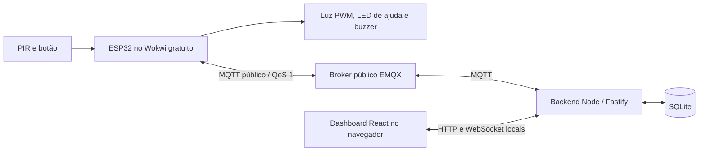

# NightCare

MVP acadêmico de Microprocessadores e Microcontroladores para apoiar deslocamentos noturnos: ESP32, sensor de movimento, luz com brilho ajustável e botão de ajuda. O cuidador acompanha o ambiente e atende chamados pelo dashboard.

**O caminho principal é gratuito:** Wokwi no navegador, broker MQTT público sem cadastro e backend/dashboard no seu computador. Não exige gateway privado, VPS, domínio, cartão ou abertura de portas no roteador. Use somente dados fictícios: o broker da demonstração é público, sem autenticação ou privacidade. O projeto é um sistema de apoio, sem certificação médica ou garantia de prevenção de quedas.

## Começar em poucos passos

Requisitos: Docker com Compose v2, Python 3, Bash, internet e navegador. No Windows, execute os comandos em um ambiente Bash com Docker integrado. Docker Desktop precisa compartilhar a pasta do projeto. Não é necessário instalar Node para executar pelo Docker.

Na raiz do projeto:

```bash
bash scripts/demo.sh
```

O script prepara uma configuração exclusiva e inicia o backend com o dashboard. Abra **http://localhost:3000**. O painel abre sem login; o dispositivo ficará offline até iniciar a simulação.

Se a porta 3000 já estiver em uso:

```bash
DEMO_HTTP_PORT=3001 bash scripts/demo.sh
```

Nesse caso, abra http://localhost:3001 e use a mesma variável em futuras execuções. Para preparar apenas os arquivos do Wokwi, sem iniciar Docker:

```bash
bash scripts/demo.sh --prepare-only
```

O script gera `.env.demo`, `Wokwi/mqtt_demo.h` e um pacote em `Wokwi/demo/`. Ele reutiliza o identificador nas execuções seguintes, não altera `.env`, `secrets/` ou `mqtt_secrets.h` da modalidade TLS e recusa substituir um `mqtt_demo.h` que pertença a outra configuração. Não copie `.env.demo` entre demonstrações independentes: cada instalação precisa de seu próprio prefixo.

### Iniciar a simulação gratuita

1. Abra o [circuito original no Wokwi](https://wokwi.com/projects/479504505300117505) e crie sua cópia.
2. Substitua `sketch.ino`, `diagram.json` e `libraries.txt` pelos arquivos de **`Wokwi/demo/`** gerados pelo script.
3. No editor do Wokwi, crie um arquivo/aba com o nome exato **`mqtt_demo.h`** e cole todo o conteúdo de `Wokwi/demo/mqtt_demo.h`. Salve antes de iniciar a simulação. Os quatro arquivos necessários são `sketch.ino`, `diagram.json`, `libraries.txt` e `mqtt_demo.h`; **não é necessário adicionar `mqtt_secrets.h`, `mqtt_secrets.example.h` ou `mqtt_demo.example.h`**. Não copie `wokwi.toml` para o navegador.
4. Inicie a simulação. Use o gateway público padrão; não habilite o gateway privado.
5. No monitor serial, acompanhe Wi-Fi e a mensagem MQTT conectado. No painel, aguarde o dispositivo ficar online.
6. Clique no PIR e em **Simulate Motion**. Pressione o botão AJUDA para abrir um chamado.

A rede simulada é `Wokwi-GUEST`, sem senha, e o NTP usa `pool.ntp.org`. Aguarde a sincronização antes de reconhecer/encerrar pelo painel. Para testar iluminação durante o dia, envie pelo painel agenda **00:00–00:00**, ou use o modo **Ligado**. Horários iguais significam funcionamento automático 24 h.

O ESP32 conecta a `broker.emqx.io:1883` pela internet; o backend conecta ao mesmo broker. **Não use `localhost`, `mosquitto` ou `host.wokwi.internal` como endereço MQTT no Wokwi deste roteiro.** O gateway público não acessa sua rede local. [Rede e gateway público do Wokwi](https://docs.wokwi.com/guides/esp32-wifi)

### Credenciais e parâmetros da demo

| Parâmetro | Valor / origem |
| --- | --- |
| Broker | `broker.emqx.io`, TCP `1883` |
| Usuário e senha MQTT | vazios; serviço público sem autenticação |
| Login/token do painel e API | dispensados com `DEMO_MODE=true` |
| Wi-Fi | `Wokwi-GUEST`, senha vazia |
| Prefixo MQTT | `nightcare/demo/<identificador>/nightcare-001/` |
| Identificador da instalação | 16 caracteres hexadecimais gerados em `.env.demo` |
| Client IDs | `nightcare-<identificador>-backend` e `nightcare-<identificador>-device` |
| API/dashboard | `http://localhost:3000`, apenas loopback |

Não há segredos a solicitar ou configurar no modo demo. O prefixo exclusivo evita colisões acidentais, mas qualquer pessoa pode ler ou publicar mensagens se conhecer o tópico. Nunca envie dados pessoais ou credenciais por esse broker. O EMQX disponibiliza o serviço para protótipos e testes, sem necessidade de preparar infraestrutura. [Endereço e portas do broker público](https://www.emqx.com/en/mqtt/public-mqtt5-broker)

## Arquitetura



O ESP32 controla iluminação, agenda, debounce e sinalização de ajuda. A rede roda em tarefa própria e entrega mensagens ao loop por fila FreeRTOS. Falha de internet não interrompe PIR, botão ou saídas locais.

O broker encaminha eventos, estado, configurações e comandos. O backend valida as mensagens, registra histórico em SQLite e confirma ações somente após resposta do dispositivo. O dashboard acessa o backend; não conecta diretamente ao ESP32 nem ao broker.

O frontend React/TypeScript é compilado com Vite e servido pelo próprio Fastify. HTTP e WebSocket usam o mesmo endereço, sem outro servidor de frontend. O backend envia snapshots iniciais e alterações por `/ws`; o painel reconecta automaticamente e recupera o histórico. O banco usa WAL e preserva configurações desejadas, pedidos e comandos antes de publicá-los.

| Parte | Arquivos principais |
| --- | --- |
| Firmware e circuito | `Wokwi/sketch.ino`, `Wokwi/diagram.json` |
| Dashboard | `frontend/src/` |
| API, MQTT e SQLite | `backend/src/` |
| Execução gratuita | `compose.demo.yml`, `scripts/demo.sh` |
| Alternativa com broker próprio/TLS | `compose.yml`, `mosquitto/`, `scripts/setup.sh` |
| Testes | `backend/test/`, `scripts/test-*.sh` |

### Estados e confirmações

Iluminação, assistência e comunicação são independentes. Desconectar MQTT não encerra um chamado nem muda o modo de luz.

O painel apresenta conexão WebSocket, broker e dispositivo separadamente. Estado retido é uma fotografia: o backend espera mensagem nova para indicar presença e considera offline após **45 s** sem atualização, ou ao receber `offline`. O ESP32 envia heartbeat a cada **15 s**.

Ao enviar configuração, o painel mostra a versão desejada e a versão aplicada pelo ESP32. Um HTTP **202** indica intenção registrada; a confirmação vem de `acks` ou de `state.appliedConfigVersion`. Mudanças locais por serial não incrementam a versão remota: confira também os valores atuais nos cartões.

O botão abre um pedido `PENDING`. **Reconhecer** muda para `ACKNOWLEDGED`; **Encerrar** só é permitido depois e retorna a `NONE`. Chamados não expiram com a luz. Novos cliques reiteram o mesmo pedido. O painel mantém o aviso, mostra o tempo desde a primeira observação da abertura e oferece som ativado pelo usuário; exige aba aberta e conectada. Para registros anteriores à migração, a abertura usa o primeiro recebimento disponível, ou a última atualização quando não há histórico.

Comandos exibem enviado, confirmado, recusado ou **não confirmado** após dez segundos sem ACK. São válidos por 60 s. O painel bloqueia ações incompatíveis e aguarda a confirmação; o backend e o firmware também validam pedido, relógio e transição. Um ACK MQTT de transporte não confirma atendimento.

## Circuito e controle local

| Componente | Ligação |
| --- | --- |
| PIR OUT | GPIO 27, alimentação 5 V e GND |
| Botão AJUDA | GPIO 14 e GND, `INPUT_PULLUP` |
| LED branco, representando luminária | GPIO 25, resistor 220 Ω e GND |
| LED vermelho de assistência | GPIO 26, resistor 220 Ω e GND |
| Buzzer | GPIO 32 e GND |

Padrões: `AUTO`, brilho **30%**, prazo **30 s**, agenda **22:00–06:00**, São Paulo/UTC−3 fixo. O início da agenda é inclusivo e o fim exclusivo. `ON` mantém luz no brilho configurado; `OFF` mantém apagada. Em `AUTO`, sair da agenda apaga imediatamente. PIR ativo mantém luz ligada; o prazo começa quando fica inativo e novo movimento cancela o desligamento.

Sem relógio válido, `AUTO` aceita movimento o dia todo e informa `clockValid=false`. O botão funciona a qualquer hora, inclusive com luz desligada. Debounce: 50 ms. Pedido pendente: LED alterna a cada 500 ms e buzzer toca 100 ms a cada 5 s. Reconhecido: LED aceso e buzzer silencioso.

Monitor serial, 115200 baud:

```text
auto
on
off
brilho 30
tempo 30
agenda 22:00 06:00
fuso -3
hora 21:59
hora real
hora invalida
reconhecer
encerrar
status
ajuda
reiniciar
rede off
rede on
```

Brilho aceita 1–100%, prazo 1–600 s, e `fuso` aceita inteiro −12..+14. A configuração remota usa `America/Sao_Paulo`, mapeado para UTC−3 sem regras de horário de verão. `hora HH:MM` congela o relógio para testar agenda; `hora invalida` simula falha. Ambos impedem comandos remotos: use `hora real` e aguarde NTP antes de atender pelo painel. Reconhecimento/encerramento seriais são controles locais de teste.

Configuração e chamado ativo são gravados em NVS. Teste primeiro com `reiniciar`; parar e reabrir o Wokwi é outro cenário, pois a persistência depende do simulador. A fila de eventos e o contador de perdas estão em RAM e desaparecem no reboot.

## Roteiro de validação pelo usuário

Mantenha monitor serial e dashboard abertos. Anote ação, resultado esperado e observado. Ao terminar testes de horário, use `hora real`. Se uma configuração desejada retida for reaplicada após reinício, ela pode substituir alterações seriais de teste.

| Cenário / ação | Resultado esperado |
| --- | --- |
| Painel: `AUTO`, brilho 55%, agenda 00:00–00:00, prazo 5 s | versão desejada avança e aplicada é confirmada; movimento acende no brilho escolhido |
| Serial: `agenda 22:00 06:00`, `auto`, `hora 21:59`, movimento | luz apagada |
| `hora 22:00`, movimento | luz acesa |
| `hora 05:59`, depois `hora 06:00` | movimento permitido antes do fim; luz apaga no fim |
| PIR inativo, novo movimento antes do prazo | desligamento cancelado; contar novamente após PIR inativo |
| `off`, pressionar AJUDA e manter pressionado | um clique abre um chamado mesmo fora da agenda; manter pressionado não gera novos cliques |
| Soltar e pressionar AJUDA novamente | mesmo requestId e reiteração no histórico |
| `hora real`, aguardar NTP; painel: Reconhecer | confirmação, estado reconhecido, LED contínuo e buzzer silencioso |
| Recarregar o painel antes de encerrar | chamado continua visível, com horário de abertura preservado |
| Painel: Encerrar | confirmação, estado sem chamado e evento distinto no histórico |
| Ativar aviso sonoro e abrir outro chamado | aviso sonoro com painel aberto; reconhecer silencia |
| Filtrar histórico por tipo e período | apenas eventos correspondentes; período usa horário de recebimento no backend |
| `hora invalida`, movimento | controle local aceita movimento em AUTO; painel mostra relógio inválido e bloqueia comandos |
| Enviar brilho 0 pela API | HTTP 400; nenhuma configuração parcial aplicada |
| Reenviar comando com mesmo ID/corpo | mesma intenção, sem segunda transição |
| Usar requestId antigo para pedido novo | HTTP 409 ou ACK de recusa, sem encerrar o pedido novo |
| Com pedido reconhecido, `reiniciar` | mesmo pedido e estado recuperados da NVS |

### Falha de rede e recuperação

**Parar o backend** testa sua indisponibilidade; o ESP32 pode continuar conectado ao broker. Execute em outro terminal:

```bash
docker compose --env-file .env.demo -p nightcare-demo -f compose.demo.yml stop backend
# Teste PIR e botão no Wokwi e observe a perda de atualização do painel.
bash scripts/demo.sh
```

Depois de voltar, o painel reconecta; SQLite mantém os registros anteriores e o estado atual chega novamente. Eventos publicados enquanto o backend estava parado podem não entrar no histórico: a confirmação QoS 1 do broker permite ao ESP32 removê-los da fila, e a assinatura do backend usa sessão limpa. O chamado ativo continua recuperável pelo estado retido e pela NVS.

**Interromper a rede do ESP32** testa a fila e o controle local offline. Na demo, envie `rede off` no monitor serial: o firmware desliga a conexão Wi-Fi e suspende sua reconexão automática, mantendo o loop local executando. Teste PIR e botão e aguarde até 45 s para verificar offline no painel. Envie `rede on` para reconectar sem reiniciar nem apagar a fila. Esses comandos só existem na compilação demo e não são persistidos. Não é necessário desconectar a internet do computador nem parar o broker público compartilhado.

Com a simulação ainda executando, confirme PIR e botão responsivos, offline no painel por Last Will ou timeout, e retorno do estado ao reconectar. Gere mais de 100 eventos durante a interrupção — por exemplo, alternando `on`/`off` e pressionando AJUDA — e confira `droppedEvents`. A fila descarta primeiro o evento comum mais antigo; se todos forem de assistência, descarta o mais antigo. Ao reconectar, eventos pendentes são reenviados e deduplicados por `eventId`. Teste de fila no firmware exige execução efetiva, não é comprovado pelo cliente MQTT dos testes automatizados.

### Testes automatizados e compilação

```bash
bash scripts/test-backend.sh
bash scripts/test-demo.sh
bash scripts/test-integration.sh
bash -n scripts/demo.sh scripts/setup.sh scripts/test-backend.sh scripts/test-demo.sh scripts/test-integration.sh
```

Os testes usam Node 22 em Docker. `test-demo.sh` cria broker anônimo **isolado, sem publicar portas**, backend e SQLite temporários; verifica dashboard servido, WebSocket, configuração confirmada, ajuda/reconhecimento/encerramento, deduplicação, relógio inválido e recuperação de presença. `test-integration.sh` valida a alternativa TLS, autenticação, ACL, Last Will e persistência após reinício. Ambos usam clientes MQTT que representam o dispositivo; não executam o firmware. Os scripts removem seus próprios contêineres/volumes e preservam diagnóstico em `.validation/`.

Para compilar localmente, instale PlatformIO Core **6.1.18**:

```bash
bash scripts/demo.sh --prepare-only
pio run -e esp32demo
# Alternativa TLS:
pio run -e esp32dev
```

O ambiente fixa `espressif32@6.12.0`, Arduino ESP32 2.0.17 e ArduinoJson 7.4.2. O pacote gerado inclui `wokwi.toml` com o binário demo para uso opcional da extensão VS Code; o caminho principal é o navegador gratuito. A variante ESP-IDF 5 do código não está validada.

Os resultados efetivamente obtidos estão em [docs/VALIDACAO.md](docs/VALIDACAO.md). Compilação e cliente MQTT não substituem testes do circuito no Wokwi.

## API e tópicos MQTT

Na demo, exemplos funcionam sem token:

```bash
curl -fsS http://localhost:3000/api/status
curl -fsS 'http://localhost:3000/api/events?limit=20&type=HELP_OPENED'
curl -fsS -X POST http://localhost:3000/api/config \
  -H 'Content-Type: application/json' \
  -d '{"mode":"AUTO","brightnessPct":55,"offDelaySec":5,"startTime":"00:00","endTime":"00:00","timezone":"America/Sao_Paulo"}'
```

| Rota | Uso |
| --- | --- |
| `GET /health/live` | processo HTTP ativo |
| `GET /health/ready` | SQLite e conexão MQTT; 503 sem broker |
| `GET /ui-config` | informa se o modo demo está ativo |
| `GET /api/status` | dispositivo, configurações, chamados, comandos e contador de eventos |
| `GET /api/events?limit=100&type=...&from=...&to=...` | histórico; datas ISO UTC, limite 1–500 |
| `POST /api/config` | configuração completa; backend atribui versão crescente |
| `POST /api/commands` | `commandId`, `requestId`, `action: ACK_HELP ou CLOSE_HELP` |
| `GET /api/commands/:id` | resultado da intenção |
| `GET /ws` com upgrade WebSocket | `{type:"snapshot",data:...}` inicial e ao mudar dados |

Para comandos manuais, copie o requestId ativo de `/api/status`. Use um ID novo por intenção e repita o mesmo corpo/ID apenas para repetir a mesma intenção:

```bash
curl -fsS -X POST http://localhost:3000/api/commands \
  -H 'Content-Type: application/json' \
  -d '{"commandId":"demo-ack-001","requestId":"ID_ATIVO","action":"ACK_HELP"}'
curl -fsS http://localhost:3000/api/commands/demo-ack-001
```

Aguarde `APPLIED` e `ACKNOWLEDGED` no estado; depois envie `CLOSE_HELP` com outro commandId. HTTP 400 indica entrada inválida; 409 indica conflito, offline, relógio inválido ou transição incompatível. Na modalidade TLS, `/api/` exige `Authorization: Bearer TOKEN`, e `/ws` exige mensagem inicial `{type:"auth",token:"..."}`; o painel oferece campo para esse token, mantido apenas em memória.

Todos os tópicos abaixo usam o prefixo da instalação. Payloads preservam `schemaVersion:1` e `deviceId:"nightcare-001"`.

| Sufixo | Direção | QoS | Retido |
| --- | --- | --- | --- |
| `events` | ESP32 → backend | 1 | não |
| `state` | ESP32 → backend | 1 | sim |
| `availability` | ESP32 → backend | 1 | sim, Last Will offline |
| `config/set` | backend → ESP32 | 1 | sim |
| `commands` | backend → ESP32 | 1 | não |
| `acks` | ESP32 → backend | 1 | não |

Eventos têm eventId exclusivo por dispositivo/boot/contador, tipo, uptime, requestId quando aplicável e horário UTC ou `null`. SQLite deduplica pelo eventId. O estado inclui sequência, modo, luz, brilho, movimento, assistência, relógio, versão aplicada, perdas e persistência. Configurações inválidas ou antigas são rejeitadas integralmente; repetição igual não regrava NVS. Comandos repetidos não repetem transições; pedido e resultado são gravados atomicamente na NVS com diário dos últimos 16 comandos.

## Operação, desenvolvimento e alternativa TLS

```bash
# Diagnóstico da demo
docker compose --env-file .env.demo -p nightcare-demo -f compose.demo.yml ps
docker compose --env-file .env.demo -p nightcare-demo -f compose.demo.yml logs --tail=100 backend
# Parar preservando SQLite
docker compose --env-file .env.demo -p nightcare-demo -f compose.demo.yml down
```

`down` preserva o volume do banco. `down -v` apaga o histórico e deve ser usado apenas para descarte intencional. A disponibilidade da demo depende do broker público. Se não conectar, confira internet, saída TCP 1883, host e igualdade do prefixo nos arquivos copiados ao Wokwi. Broker conectado com dispositivo offline indica que falta estado novo do ESP32; aguarde heartbeat. NTP inválido bloqueia comandos remotos, mas não a conexão MQTT sem TLS.

Para desenvolvimento sem Docker, use **Node >=22.13**; a imagem fixa **22.21.1**. SQLite nativo pode exigir Python/make/g++. Execute `npm ci --prefix backend`, `npm ci --prefix frontend`, os builds de ambos e inicie o backend com `DEMO_MODE=true`, `MQTT_URL`, `MQTT_PREFIX`, `MQTT_CLIENT_ID` da `.env.demo` e `STATIC_ROOT` apontando para o caminho absoluto de `frontend/dist`. `HOST` padrão é `127.0.0.1`, porta 3000, e `DB_PATH` padrão é `./data/nightcare.sqlite`. Execute `npm start --prefix backend`. Há somente uma instância do backend por instalação e banco.

A modalidade anterior com Mosquitto próprio/TLS permanece **opcional**, separada da demo. Em uma configuração nova com um host acessível pela internet:

```bash
bash scripts/setup.sh HOST_PUBLICO
docker compose up --build -d
```

Ela exige DNS/IPv4 acessível e TCP 8883; gera CA, certificado SAN para host e `mosquitto`, usuários separados e token aleatório. O script recusa sobrescrever `.env`, `secrets/` ou `mqtt_secrets.h`. Para o firmware TLS, use `Wokwi/sketch.ino`, circuito, bibliotecas e `mqtt_secrets.h`, com `#define NIGHTCARE_DEMO 0` na primeira linha para selecionar TLS explicitamente; esse caminho não usa o pacote `Wokwi/demo/`. TLS valida CA, hostname e data; não usa aceitação indiscriminada de certificados. A API permanece local e exige o token gerado; em servidor remoto, pode ser acessada por túnel SSH. Não publique credenciais reais em projetos Wokwi compartilhados.

Faça backup de SQLite com backend parado ou pela API de backup do SQLite; não ignore o WAL ao copiar um banco em uso. O projeto continua limitado a um dispositivo, UTC−3 fixo e eventos pendentes em RAM. Uma luminária física exige circuito de potência e alimentação apropriados; o LED representa essa saída na simulação.
