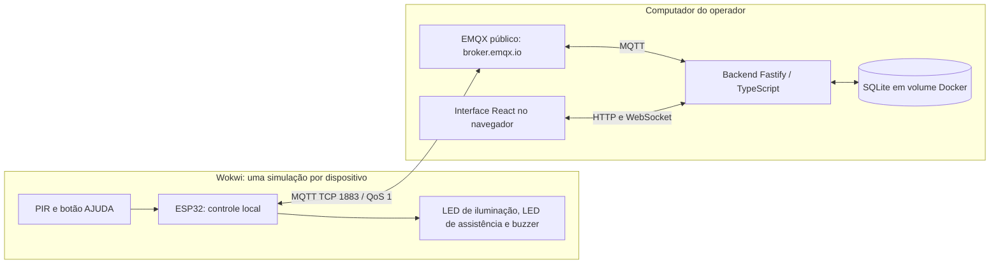
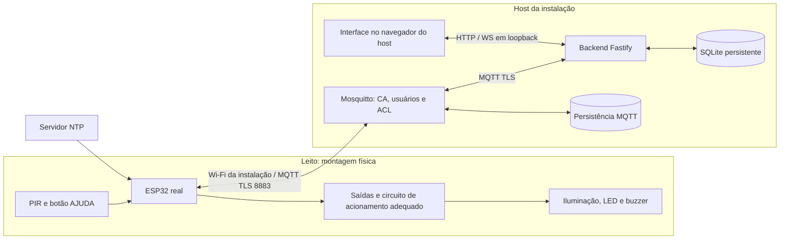
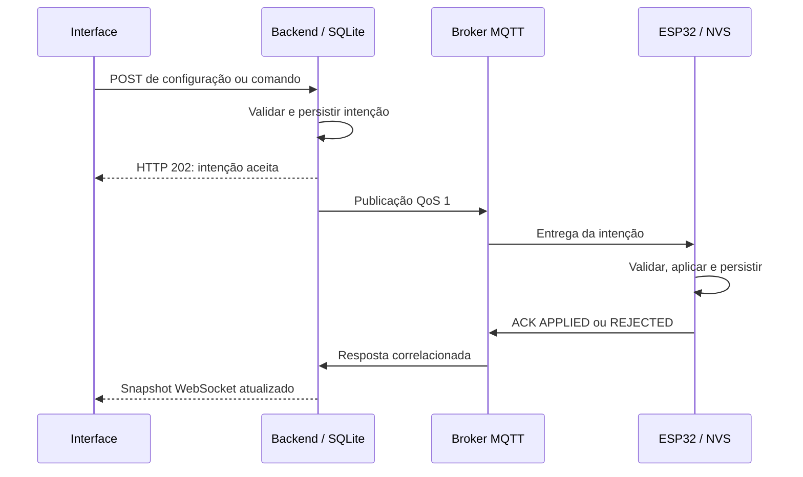
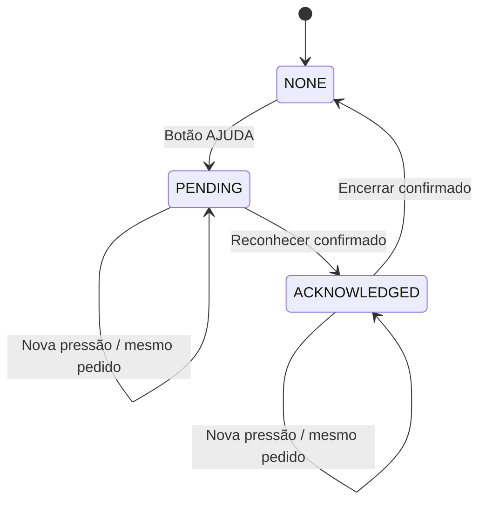

# Arquitetura — NightCare

[Índice da documentação](../README.md) · [Instalação](manual.md) · [Interface e API](interface.md)

O NightCare separa controle local, transporte MQTT e supervisão web. Há um ESP32 independente por leito e um backend por instalação. O nome do leito existe no backend; o firmware conhece somente sua identidade técnica (`deviceId`).

## Primeira etapa: Wokwi e broker público

Este é o caminho de prototipação e apresentação: simulação gratuita no navegador, MQTT público e aplicação local em Docker.

ESP32 e backend conectam-se ao mesmo broker; não há conexão direta entre Wokwi e computador. O gateway público do Wokwi dá acesso à internet, mas não à rede local do operador. Por isso o firmware da demo não usa `localhost`, `mosquitto` ou `host.wokwi.internal`. A rede simulada é `Wokwi-GUEST`, sem senha. [Documentação oficial de rede do Wokwi](https://docs.wokwi.com/guides/esp32-wifi).

O script gera namespace aleatório `nightcare/demo/<sessão>/` e identidades MQTT distintas. O header `mqtt_demo.h` leva esses parâmetros ao firmware. Namespace reduz colisões acidentais; não autentica o dispositivo. O broker público permite leitura/publicação de terceiros e a demo usa TCP sem criptografia. [Broker público EMQX](https://www.emqx.com/en/mqtt/public-mqtt5-broker).

O backend serve os arquivos compilados da interface em `http://localhost:3000`. No desenvolvimento, Vite em `http://localhost:5173` encaminha HTTP/WS ao mesmo backend. A interface não se conecta ao broker. Dois leitos usam dois projetos Wokwi e dois pacotes, com IDs próprios.

## Segunda etapa do projeto: ESP32 real e Mosquitto próprio

**Esta é a evolução para montagem física e infraestrutura sob controle da instalação.** O repositório já oferece Compose, geração de certificados e provisionamento MQTT; isso não equivale a validação do circuito real.

O firmware valida CA, hostname e data do certificado. Cada dispositivo usa usuário igual ao `deviceId`; a ACL limita acesso aos tópicos desse usuário. Backend e healthcheck têm credenciais próprias. A chave privada da CA não é montada nos contêineres. TLS/ACL protegem MQTT; a aplicação HTTP/WS continua sem login e publicada somente em loopback.

O script atual de preparação exige DNS ou IPv4 público e emite SAN também para `mosquitto`, usado entre contêineres. Um ESP32 físico precisa alcançar esse host na porta 8883. Uma implantação exclusivamente na LAN exige adequação do provisionamento/endereço e do certificado; não é o fluxo automatizado atual. Em um host remoto, o painel local pode ser acessado por túnel SSH, sem expor HTTP diretamente.

Antes de utilizar hardware, é necessário adaptar a rede: `TimeService.begin()` ainda contém `WiFi.begin("Wokwi-GUEST", "", 6)`. Credenciais Wi-Fi reais não são configuradas pelos scripts TLS. Também são necessários montagem, alimentação, circuito de potência para luminária e ensaios do ESP32. Não conectar uma luminária diretamente a um GPIO. O procedimento de software está no [manual](manual.md#segunda-etapa-preparar-mosquitto-próprio).

## Circuito e controle local

| Elemento simulado | Ligação | Responsabilidade |
| --- | --- | --- |
| PIR | OUT no GPIO 27, alimentação 5 V/GND | Detectar movimento |
| Botão AJUDA | GPIO 14/GND, `INPUT_PULLUP` | Abrir ou reiterar pedido; debounce de 50 ms |
| LED branco | GPIO 25, resistor 220 Ω/GND | Representar iluminação PWM |
| LED vermelho | GPIO 26, resistor 220 Ω/GND | Sinalizar assistência |
| Buzzer | GPIO 32/GND | Sinalizar chamado pendente |

Os valores acima descrevem o circuito simulado; a compatibilidade elétrica dos componentes físicos deve ser verificada na segunda etapa.

Padrões: modo `AUTO`, brilho 30%, prazo de 30 s e agenda 22:00–06:00. O início é inclusivo e o fim exclusivo; horários iguais significam 24 horas. Em AUTO, movimento dentro da agenda mantém luz acesa; o prazo começa ao cessar movimento. Novo movimento cancela a contagem. Sair da agenda apaga a luz imediatamente. `ON` mantém o brilho escolhido e `OFF` mantém apagada. Sem relógio válido, AUTO permite movimento em qualquer horário, preservando o prazo.

PIR, botão, PWM e assistência são processados pelo loop local. MQTT roda em tarefa própria; callbacks entregam mensagens por fila FreeRTOS, sem executar transições ou gravações NVS. Falha de rede não deve bloquear os controles locais.

## Descoberta e isolamento

O backend assina mensagens válidas dentro da raiz MQTT da instalação e descobre identidades; não faz varredura da rede. Presença exige estado novo. Estado retido é apenas uma fotografia; heartbeat ocorre a cada 15 s, presença expira em 45 s e Last Will informa queda.

Dispositivos descobertos aparecem na Administração. O operador confirma o nome do leito com o dispositivo online. O vínculo é permanente e 1:1; admite renomeação única normalizada, sem transferência, desassociação ou substituição nesta versão. Dispositivo sem vínculo continua visível, inclusive com chamados conhecidos, mas operações remotas exigem associação.

`deviceId` aceita 1–32 letras ASCII, números, `_` e `-`; `nightcare-backend` e `nightcare-health` são reservados. IDs não dependem do MAC simulado. Eventos, versões, comandos, chamados, deduplicação e cursores são separados por dispositivo. O ID do payload deve corresponder ao tópico. Não iniciar dois clientes com a mesma identidade.

## Transporte e contratos MQTT

Um tópico completo tem a forma `<raiz>/<deviceId>/<sufixo>`. A demo usa raiz `nightcare/demo/<sessão>/`; o TLS padrão usa `nightcare/`. Todos os envelopes têm `schemaVersion: 1` e `deviceId`.

| Sufixo | Origem → destino | QoS | Retido |
| --- | --- | --- | --- |
| `events` | ESP32 → backend | 1 | Não |
| `state` | ESP32 → backend | 1 | Sim |
| `availability` | ESP32 → backend | 1 | Sim; Last Will `offline` |
| `config/set` | Backend → ESP32 | 1 | Sim |
| `commands` | Backend → ESP32 | 1 | Não |
| `acks` | ESP32 → backend | 1 | Não |

Eventos contêm ID por dispositivo/boot/contador, tipo, uptime, horário UTC ou `null` e referência do pedido quando aplicável. O evento de abertura identifica o chamado. SQLite deduplica `(deviceId, eventId)`. Estado inclui boot, sequência, uptime, iluminação, movimento, assistência, relógio, versão aplicada, perdas e persistência; `runtimeSettings` é opcional e informa parâmetros locais efetivos. Mensagens inválidas, eventos/ACKs retidos e respostas sem correlação não produzem confirmações.

Configurações são completas, versionadas e aplicadas integralmente. Versão antiga ou mesma versão com conteúdo diferente é rejeitada; repetição idêntica não regrava NVS. O fuso remoto `America/Sao_Paulo` corresponde a UTC−3 fixo, sem base IANA/horário de verão. O serial permite offsets inteiros −12..+14.

PUBACK MQTT confirma transporte, não aplicação. Configuração também pode ser confirmada por `state.appliedConfigVersion`. Comandos `ACK_HELP`/`CLOSE_HELP` correlacionam `commandId` e `requestId`, exigem UTC real válido e expiram em 60 s. Após 10 s sem resposta, aparecem como `UNCONFIRMED`; ACK posterior ainda atualiza o resultado.

Na demo, cada intenção inédita aguarda amostra NTP nova; no TLS, divergência de horário também aciona recuperação. Até oito intenções podem aguardar sincronização, por no máximo 30 s simulados, sem renovar a validade original. Falhas podem retornar `CLOCK_SYNC_TIMEOUT`, `COMMAND_QUEUE_FULL` ou `EXPIRED_OR_INVALID_TIME`. Relógio congelado de teste não autoriza atendimento remoto.

## Estados de assistência

Pendente: LED alterna a cada 500 ms; buzzer toca 100 ms a cada 5 s. Reconhecido: LED aceso e buzzer silencioso. Encerrado: ambos desligados. Nova pressão reitera o pedido sem alterar o estado, inclusive após reconhecimento. Luz, agenda e desconexão não encerram chamados.

## Persistência, recuperação e limites

| Camada | O que conserva | Limites |
| --- | --- | --- |
| NVS do ESP32 | Configuração, chamado e diário dos últimos 16 comandos | Validar em hardware; parar/reabrir Wokwi difere de `reiniciar` |
| RAM do ESP32 | Fila de 100 eventos, perdas e intenções aguardando relógio | Desaparece no reboot; assistência tem prioridade; evento sai após PUBACK |
| SQLite/WAL | Dispositivos, leitos, eventos, configurações, chamados, comandos, notificações e observabilidade | Backup consistente precisa considerar WAL |
| Broker próprio | Mensagens retidas e persistência Mosquitto | Não substitui confirmação do dispositivo |
| Navegador | Leitura de notificações por instalação/endereço | Rascunhos/perfis ficam em memória; não são cadastro de usuário |

Notificações e agregados de observabilidade têm retenção de 30 dias e limpeza horária; isso não apaga as coleções técnicas de histórico. Observabilidade distingue online, offline e sem observação: paradas do backend/broker não viram queda individual comprovada. Não há reconstrução de métricas anteriores à ativação.

Backend reiniciado invalida presença até receber estado novo e republica intenções conforme validade. Firmware reconecta com backoff de 1/2/4/8/16/30 s. Se o ESP32 permanecer conectado enquanto backend estiver parado, eventos podem ser confirmados pelo broker e faltar no histórico, pois o consumidor usa sessão limpa. A fila local cobre desconexão do dispositivo, não ausência do consumidor.

A API e WebSocket não têm autenticação em nenhuma modalidade. Som depende de aba aberta e ativação do operador; não existe push externo garantido. Ensaios e limitações efetivamente observados estão em [testes.md](testes.md).
